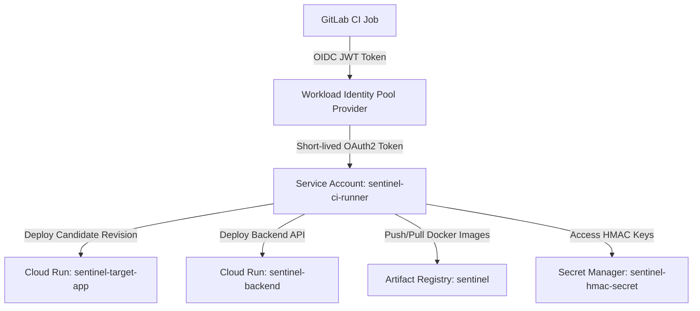

# Project Sentinel — Infrastructure & Keyless CI Architecture (Tasks K1, K2)

## 1. Cloud Architecture Overview

Project Sentinel leverages **Google Cloud Platform (GCP)** and **Cloud Run** for containerized serverless hosting, integrated seamlessly with **GitLab CI/CD** via **Workload Identity Federation (WIF)**.



---

## 2. Keyless Authentication via Workload Identity Federation (WIF)

To satisfy the zero-secret security requirement (Task K1), GitLab CI does **not** store any long-lived service account JSON keys. Instead:

1. GitLab CI generates an OIDC JSON Web Token (JWT) using the `id_tokens` directive:
   ```yaml
   id_tokens:
     GITLAB_OIDC_TOKEN:
       aud: "https://gitlab.com"
   ```
2. The CI job presents this token to Google Cloud's Security Token Service (STS) endpoint:
   `https://iamcredentials.googleapis.com/v1/projects/-/serviceAccounts/sentinel-ci-runner@project-sentinel.iam.gserviceaccount.com:generateAccessToken`
3. GCP validates that:
   * The token issuer is `https://gitlab.com`
   * The project path matches `assertion.project_path == 'project-sentinel/sentinel'`
4. GCP issues a short-lived access token (valid for 1 hour) with scoped roles (`roles/run.admin`, `roles/artifactregistry.writer`).

---

## 3. Terraform Directory Layout (`infra/`)

* [`main.tf`](../infra/main.tf) — Provider requirements and GCP settings.
* [`variables.tf`](../infra/variables.tf) — Configuration variables (project ID, region, image tags).
* [`artifact_registry.tf`](../infra/artifact_registry.tf) — Docker repository for container images.
* [`cloud_run.tf`](../infra/cloud_run.tf) — Cloud Run v2 services with traffic allocation and candidate URL tags.
* [`iam_wif.tf`](../infra/iam_wif.tf) — WIF pool, OIDC provider, and service account IAM bindings.
* [`secrets.tf`](../infra/secrets.tf) — Secret Manager configuration for HMAC secrets and tokens.
* [`outputs.tf`](../infra/outputs.tf) — Output endpoints and provider references.

---

## 4. Terraform Validation & Deployment

```bash
cd infra
terraform init
terraform fmt -check
terraform validate
terraform plan -out=tfplan
```
